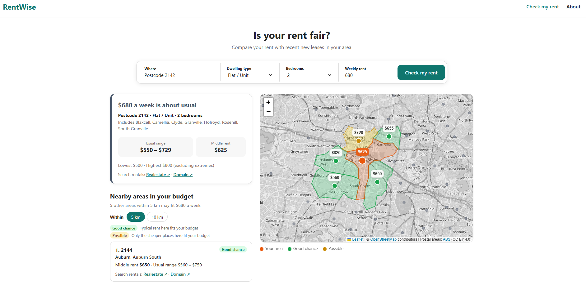
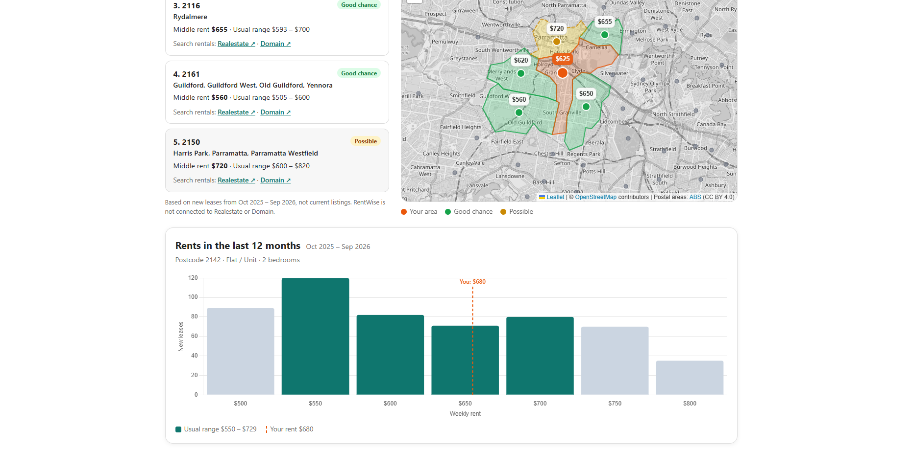

# RentWise

**Is your rent fair?** A free website that compares a NSW weekly rent with recent new leases in the same postcode.

**[Open the website →](https://rentwise-xi.vercel.app)**

**The problem:** renters only see asking prices online, not what similar homes actually rent for. NSW publishes every new lease, but the data is hard to use. RentWise turns it into one simple check.

**Compared with NSW [Rent Check](https://www.nsw.gov.au/rent-check):** Rent Check shows the middle 50% of rents for the last 3 months. RentWise uses 12 months for larger samples (e.g. 60 leases instead of 13 for 2-bedroom houses in 2142), includes studios, and adds nearby areas within a budget, a chart of where rents fall, and links to listings.

*Solo project, about 2 months, from requirements to a live website.*

---

## 1. Business requirements

| ID | Priority | User story | Done when |
|---|---|---|---|
| W-01 | Must | As a renter renewing a lease, I want to check my rent against similar new leases, so I know if it is lower, about or higher than usual. | The result uses the same postcode, dwelling type and bedrooms. Fewer than 30 leases shows a warning. |
| W-02 | Should | As a renter whose rent has gone above my budget, I want to see nearby areas where my budget may work, so I know where to look. | Areas within 5 or 10 km are labelled Good chance or Possible, with links to listings. |
| W-03 | Should | As a renter who doesn't know what is normal because everywhere seems expensive, I want to see where most recent rents fall. | A chart shows the leases at each price, with the usual range and my rent marked. |

**From renter questions to data questions**

| Renter asks | Data question |
|---|---|
| Is my rent fair? | Where does it sit against the 25th–75th percentile of similar leases in the latest 12 months? |
| Where can I afford? | Which areas within 5 or 10 km have a median or 25th percentile within my budget? |
| What is normal here? | How many leases were at each price in the latest 12 months? |

**Not in scope:** recommending "the best place for you" (the data only has rent), current listings, and rent history (that is in the [Power BI dashboard](https://github.com/Isla-HsiaoTing-Shen/RentWise)).

## 2. Data collection

NSW Fair Trading rental bond lodgements, loaded and cleaned in the **[RentWise data pipeline →](https://github.com/Isla-HsiaoTing-Shen/RentWise)**

## 3. Data transformation

- **Latest 12 months:** found from the newest month in the data, so it moves forward on its own.
- **Usual range** = 25th–75th percentile. **Lowest · Highest** = 5th–95th, not min/max.
- **30+ leases** for a reliable result, in line with NSW's own reports, which flag figures under 30 bonds ([BR-02](https://github.com/Isla-HsiaoTing-Shen/RentWise/blob/main/docs/business_requirements.md#10-business-rules--definitions)).
- **Coverage:** 1,694 of 5,233 combinations have 30+ leases, but they cover 89.8% of all new leases.
- **Good chance:** median ≤ budget. **Possible:** 25th percentile ≤ budget < median.
- **Map:** kept only NSW postcodes with data and simplified the boundary lines (78 MB → 1.3 MB), so the map loads quickly on a phone.

SQL: [07_export_for_web.sql](https://github.com/Isla-HsiaoTing-Shen/RentWise/blob/main/sql/07_export_for_web.sql)

## 4. Testing and validation

**User testing:** feedback from renters who tried the site, and what changed.

| Feedback | Change |
|---|---|
| "Clean, but 2025 data is too old – the market moves fast" | Switched to the latest 12 months, updated every 3 months |
| "I want the lowest and highest rents to see where others are" | Added Lowest · Highest, using the 5th–95th percentile to leave out extreme cases ($243 and $6,000) |
| "I've checked my rent – now what?" | Added links to Realestate and Domain with the search already filled in |

**Checked against NSW Rent Check** (same 3 months, 5 combinations): an exact match for the 3 with 165+ leases. The 2 with only 12–13 leases differed by up to $51, which is why RentWise warns below 30 leases.

**Checks:**

- Every month in the database comes from one file (no double loading), and the export stops if a month is missing.
- Realestate and Domain links tested by hand for every dwelling type and bedroom option.
- The chart's usual range matches the result card.
- A suburb name in several postcodes (e.g. Red Hill, 3) asks the user to choose.

**Limitations:**

- Only **new** leases with a bond. Long-term tenants often pay less.
- Data is by **postcode**, so suburbs in the same postcode share one result.
- The data doesn't know a home's street, condition or distance to transport.

## 5. Production

A static site (HTML, CSS, JavaScript) on Vercel, deployed from GitHub. It reads exported JSON files instead of connecting to the database: free to host, fast, and no database password in the code. No user data is collected.

**AI use:** I defined the requirements, rules and design, and tested every change. Claude helped write the website code.

## 6. Monitoring and improvement

**When new monthly files are published (every 3 months):**

1. Put the files in the pipeline's `data/` folder.
2. Run `load_bonds.py` – loads only the new files and checks nothing was loaded twice.
3. Run `03_create_clean_tables.sql` – applies the same cleaning rules to the new rows.
4. Run `export_for_web.py` – finds the newest month, checks all 12 months are there, and writes the JSON files.
5. Check the site locally and push. Vercel updates the live site.

No code or dates need changing. [Full steps →](https://github.com/Isla-HsiaoTing-Shen/RentWise#updating-the-data-every-3-months)

**Decision log**

| Change | Why |
|---|---|
| Two pages → one | Checking a rent and finding areas are the same person's question |
| Trend chart → spread of recent rents | Past rents don't help a renter decide today; monthly points had too few leases |
| Removed "Cheapest" sort | The cheapest areas were usually the furthest away |
| Typed suburb names must be picked from the list | 162 suburb names are in more than one postcode |

**Next:** test with more renters, and tell apart more suburbs that share a name.

---

**Data:** NSW Fair Trading (CC BY), ABS Postal Areas (CC BY 4.0), Matthew Proctor postcodes, © OpenStreetMap contributors (ODbL).
Not connected to Realestate or Domain. A guide only, not financial or legal advice.

